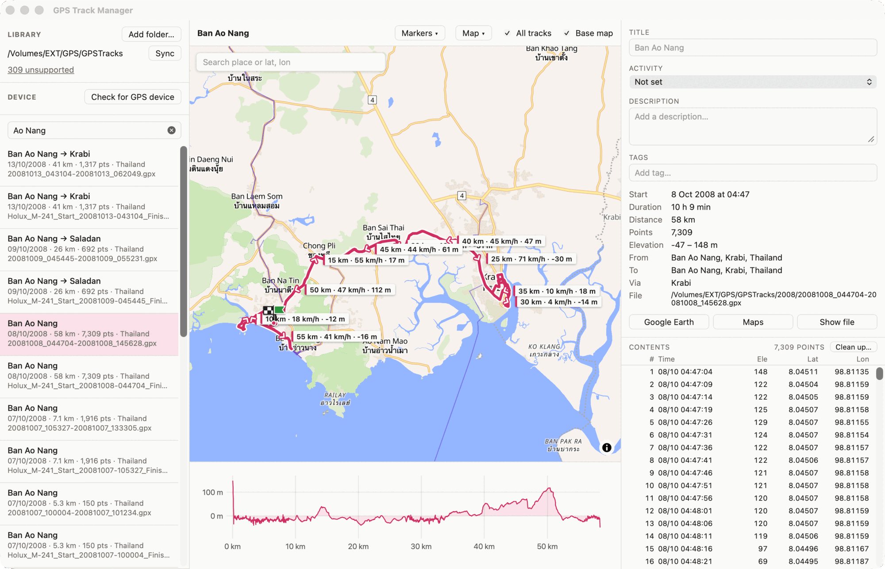

# GPS Track Manager

A desktop app for people with years of GPS tracks lying around in folders. Point it at those
folders and it builds a searchable library of every track. Your files stay where they are, and
nothing in them changes unless you ask for it.



## What you can do

**Browse your whole archive**

- Add one or more folders as your library. The app finds every track file in them (GPX, FIT,
  KML, NMEA and more, see [Supported files](#supported-files)), also files with several tracks or
  hundreds of thousands of points, and keeps up with new and changed files when you press **Sync**.
- See every track of the list on one map (a search narrows the map down too), or turn off
  **All tracks** to see only the selected one. Click a line on the map to select its track.
- Stays fast with big archives: thousands of tracks and millions of points show on the map at
  once and still pan and zoom smoothly.
- Search by place, country, title, description, tag, activity or file name. Every track knows
  where it starts and ends and which towns it passes, so "Krabi" or "Thailand" just works, even
  for tracks without a name.
- Turn off **Base map** to see the tracks alone, or pick a light, dark or black map theme.

**Look at one track**

- The map zooms to the selected track. **Markers** adds start and end flags, distance markers,
  waypoints and laps, with labels for distance, speed, altitude and time. The line can be coloured
  by speed or altitude, or drawn as points.
- Below the map, the elevation profile follows your mouse: hover over it and a marker moves along
  the track.
- On the right you find duration, distance, elevation range, start, end and the places passed,
  and every single point with its time, elevation and position.
- Give tracks a title, a description, tags and an activity (walking, hiking, bike, car, train,
  boat, aeroplane, …).
- Open the track in **Google Earth**, its area in **Maps**, or its file in Finder.
- Jump anywhere on the map with the search field on it: type a place or `lat, lon`.

**Fix and edit tracks**

- Select points in the point list (click, Shift-click, ⌘-click, ⌘A), or on the map when the
  track is drawn as points, then delete them with ⌫ or the right-click menu. The same menu splits
  a track at a point.
- Right-click a segment to delete it, join it with the next one, or make it a track of its own.
- **Clean up…** removes typical logger junk in one go: the scatter while the logger lay still
  (left on indoors, for example), points at latitude or longitude 0, and spikes more than 100 km
  off the track.
- GPS glitches and recording gaps never show up as straight lines across the map and do not
  count as distance.
- ⌘Z undoes the last edit. **Revert to file** throws away all point edits and split-off parts
  of a file.

**Import from GPS devices**

- Connect your GPS (for example a Garmin) and press **Check for GPS device**. The app lists the
  track files on it, marks the ones you already have, and copies the new ones into your library,
  sorted by year. The device itself is never changed.

## Your files are safe

All edits, titles, tags and descriptions live in the app's own catalog, not in your files. A track
file changes only when you choose **Write to file…**. Even then:

- the old file is kept next to it as `name.bak` (then `name.2.bak`, …),
- the new file is read back and checked against the catalog before it replaces anything,
- file permissions, Finder tags and the creation date are kept.

A file in any other format (FIT, KML, NMEA, …) is written as a new `.gpx` next to it. The
written file holds what you see in the app; anything the import skipped (such as sensor data)
stays in the backup.

## Where your data is stored

Titles, tags, edits and a fast copy of all points live in the app's own database:
`~/Library/Application Support/de.wellnerbou.gpstrackmanager/catalog.sqlite`. That keeps the map
fast and your files untouched. Back it up along with your tracks.

The catalog is not updated automatically: files you add or change outside the app show up after
you press **Sync**. Adding a folder and importing from a GPS device update it right away.

## Privacy

Your location history stays on your computer. Place names are looked up offline, from a list of
towns built into the app. What does go online: map tiles (from [OpenFreeMap](https://openfreemap.org)),
and the text you type into the place search on the map (sent to [Photon](https://photon.komoot.io)).

## Installing

The app is for macOS on Apple Silicon (M1 or newer).

1. Download the `.dmg` file of the
   [latest release](https://github.com/paulwellnerbou/gpstrackmanager/releases/latest), open it
   and drag **GPS Track Manager** to your Applications folder.
2. Open the app. The first time, macOS refuses because the app is not notarized by Apple: click
   **Done**, then go to **System Settings → Privacy & Security**, scroll down to the message about
   GPS Track Manager and click **Open Anyway**. After that it opens normally.
3. Click **Add folder…** and choose the folder with your tracks. The first scan of a large
   archive takes a while; later syncs only look at new and changed files.

### Building it yourself

On an Intel Mac, or to run the latest code, build the app from source. You need
[Node.js](https://nodejs.org), [Rust](https://rustup.rs) and the Xcode command line tools
(`xcode-select --install`).

```bash
git clone https://github.com/paulwellnerbou/gpstrackmanager.git
cd gpstrackmanager
npm install
npm run tauri build
```

The app is then in `src-tauri/target/release/bundle/macos/`.

## Supported files

- **GPX** (tracks, routes, waypoints) and **FIT** (Garmin activities, with laps).
- **KML** and **KMZ** (Google Earth): lines and `gx:Track` tracks become tracks, placemarks
  become waypoints. Holux ezTour KML stores a track's times as one placemark per point, named
  with the time but without a time zone; those times are read in your computer's time zone.
- **NMEA** logs (`RMC` and `GGA` sentences).
- **Holux** loggers such as the M-241: binary `.trl` track logs and ezTour `.itm` projects (all
  tracks and points of interest of the project).
- TCX, PLT, IGC and CSV files are found and listed as unsupported for now (the link under the
  library folder shows them).

## For developers

Tauri 2 app: Rust core (`src-tauri/`) with a React, TypeScript and MapLibre UI (`src/`).

```bash
npm install
npm run tauri dev
```

Headless import check against a folder (the catalog file is created if missing):

```bash
cd src-tauri && cargo run --release --example scan -- /tmp/catalog.sqlite /path/to/tracks
```

- **Catalog**: SQLite in the app data dir (`~/Library/Application Support/de.wellnerbou.gpstrackmanager/catalog.sqlite`).
  Library folders are scanned incrementally (size + mtime); points are stored as compact binary columns.
- **Huge tracks**: GPX and KML are parsed streaming (`quick-xml`), never as a DOM. Each point stores its
  Douglas–Peucker importance, so any zoom level is one filter pass; the map only receives the
  points visible in the viewport at screen resolution.
- **Devices**: mounted volumes with track files in known folders (`Garmin/Activity`, `GPX`, …).
  Imports copy into `<library>/<year>/`. A grown `Current.gpx` replaces its earlier copy, unless
  “Write to file…” wrote edits into that copy; then it is imported next to it.
- **Places**: GeoNames places with ≥ 1000 inhabitants (`src-tauri/data/places.tsv.gz`, built by
  `examples/build_places.rs`).
- **Glitches**: jumps faster than 300 m/s and recording gaps (> 2 km after > 5 min) start a new
  segment.
- **Layout**: `src-tauri/src/` holds `parse/` (GPX, FIT, KML/KMZ, NMEA, TRL, ITM), `lod.rs`, `process.rs`, `catalog.rs`,
  `scan.rs`, `device.rs`, `edit.rs`, `cleanup.rs`, `export.rs` (KML, GPX), `places.rs` and
  `lib.rs` (Tauri commands); `src/` holds `App.tsx` and `components/`.
- **App icon**: `src-tauri/icons/app-icon.svg`; regenerate the sizes with `npx tauri icon`.

## License

MIT, see [LICENSE](LICENSE). The embedded place data in `src-tauri/data/` is from
[GeoNames](https://www.geonames.org) and licensed under
[CC BY 4.0](https://creativecommons.org/licenses/by/4.0/); see [NOTICE](NOTICE).
